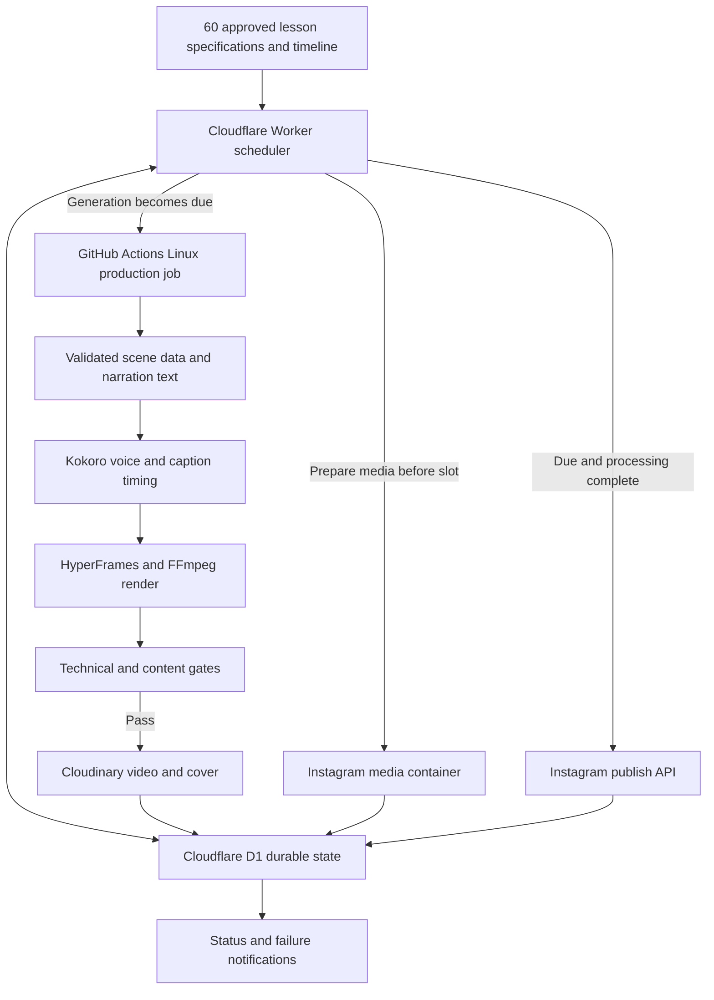

# Unattended Reel Production and Publishing — Proposed Plan

Status: implementation started after user authorization. See `automation/README.md` for executable setup. The selected cadence is Tuesday, Thursday and Saturday at 11:00 AM IST. Live publishing remains disabled until account setup and cloud pilots complete.

## 1. Desired behavior

Use the 60-lesson curriculum in `SYSTEM_DESIGN_CRASH_COURSE_MASTER_PLAN.md` as an ordered production queue. Each lesson has its own date/time. A cloud job generates its script/scene data, narration, captions and vertical MP4 before the posting slot. The publisher releases the prepared reel when due, records the Instagram post ID and advances the queue only after confirmed success.

Everything runs on hosted infrastructure while the laptop is off. The production system executes our stored instructions; this chat is not an always-running worker. Local project scheduled tasks require the computer and desktop app to be running, according to [official OpenAI documentation](https://learn.chatgpt.com/docs/automations?surface=app). Web/cloud tasks have different execution and connection capabilities; availability alone does not deploy this repository's rendering/publishing pipeline.

**Recommendation:** target $0 operating cost initially, three reels per week, generation six hours before publication, and approximate minute-level publishing. A free-tier architecture cannot promise unlimited generations, permanent quotas, zero maintenance or exact-second posting.

## 2. Recommended architecture



This architecture separates expensive rendering from a small scheduler. The scheduler makes short database/API calls and yields; it does not run Chrome, FFmpeg, TTS inference or polling loops that hold one invocation open.

[Cloudflare Worker cron triggers](https://developers.cloudflare.com/workers/configuration/cron-triggers/) can check each minute. The free Worker CPU limit is small, so the publisher and query path must be profiled before choosing the free plan permanently. Network waiting is accounted differently from CPU work. See [Worker limits](https://developers.cloudflare.com/workers/platform/limits/).

Use indexed D1 queries for due lessons and atomic state transitions. Store only lesson/job state in D1; MP4s belong in media storage. [D1 has a free allowance](https://developers.cloudflare.com/d1/platform/pricing/), with operations stopping when relevant free limits are exceeded.

## 3. Services and cost boundaries

| Need | Proposed service | $0 approach | Boundary to verify |
|---|---|---|---|
| Source, lesson specifications and reusable templates | Private GitHub repository | Repository plus small JSON/Markdown assets | Keep secrets outside source; do not store every render frame in Git. |
| Hosted production compute | GitHub Actions standard Linux runner | GitHub Free includes 2,000 monthly runner minutes and 500 MB artifact storage | Account-wide usage, reruns and artifact retention count. Benchmark complete jobs on Linux. |
| Scheduler and publisher | Cloudflare Worker | Short cron/API invocations inside free allowance | Profile CPU and request usage; no rendering here. |
| Durable queue/state | Cloudflare D1 | Tiny indexed state table within free allowance | Avoid scans, uncontrolled polling and high write volume. |
| Fresh narration text and scene content | Gemini API free-tier text model, if available to the account | Generate bounded JSON from an approved fact packet and template contract | Free quotas and model eligibility vary; rate limiting must not stop the whole course. |
| Voiceover | Kokoro open-weight TTS on the production runner | Inference uses runner CPU, without a per-character hosted speech bill | Cache the model and validate pronunciation/voice quality. |
| Video and diagrams | Existing HyperFrames CLI, local GSAP, FFmpeg and our templates | Render on the runner without a separate paid video-generation API | Pin dependencies; all fonts/scripts/media must be available in the cloud job. |
| Media URL and cover | Existing Cloudinary integration | Free plan currently offers 25 monthly credits | Credits cover multiple resource types; delivery, storage and transformations need monitoring. |
| Instagram publishing | Official Instagram publishing API | Direct integration instead of a paid social scheduler | Verify the professional account, login flow, permissions, token lifecycle and a supported API version. |
| Failure notification | GitHub job status; optional chosen alert channel | Use platform notices first | Configure any external message channel only after the user selects it. |

Official sources: [GitHub Actions billing](https://docs.github.com/en/billing/concepts/product-billing/github-actions), [Gemini pricing](https://ai.google.dev/gemini-api/docs/pricing), [Kokoro model card](https://huggingface.co/hexgrad/Kokoro-82M), [Cloudinary pricing](https://cloudinary.com/pricing).

The Gemini provider is optional. A strict-$0 fallback uses approved per-lesson narration and scene data prepared during initial course setup. It still generates voice, captions and video shortly before each slot; it does not invent a new script at that moment. Choose this fallback explicitly when configuring the course.

For fresh on-the-fly writing, use the eligible free text API first and keep a reviewed lesson-specific fallback. If no reviewed fallback exists and generation fails, hold that lesson instead of publishing invented content.

**ElevenLabs:** its free plan is for non-commercial use and requires attribution when sharing. For a potentially monetized educational channel, Kokoro is the proposed free default; a paid licensed voice can be added later. See [ElevenLabs publishing terms](https://help.elevenlabs.io/hc/en-us/articles/13313564601361-Can-I-publish-the-content-I-generate-on-the-platform). The sample's Microsoft voice demonstrates the style, but an unattended pipeline should not rely exclusively on that network-dependent client.

## 4. Generation quality without daily prompts

The master plan alone is not enough to reproduce the approved sample autonomously. Before activation, prepare three reusable inputs:

1. **Lesson packet per episode:** learning outcome, verified facts, misconceptions, sources, example assumptions, prerequisites and the one decision to teach.
2. **Production contract:** voice, palette, typography, safe areas, duration range, caption treatment, hook–failure–mechanism–boundary–takeaway structure and chapter numbering.
3. **Diagram families:** request/reply timeline, replica/version timeline, indexed lookup, sharding ring, bounded queue, workflow state machine, and an evolving architecture for case studies.

A generation API fills a schema: narration segments, diagram actors, paths, events, labels and times. Approved code renders those values. Do not allow generated arbitrary code to execute in a job holding publishing credentials.

New topic content should change the mechanism and teaching example within a suitable visual family. Reusable families need enough variation to avoid sixty visually identical reels. Bespoke art direction for every episode would be a more expensive, less predictable unattended workflow.

Automated gates before marking a reel ready:

- Required learning outcome and production caveat present; fact packet and assumptions respected.
- One concept within the chosen duration, adequate narration pace and no fabricated metrics.
- Correct scene order and full voice coverage; captions do not extend beyond the media.
- Fonts, media and scripts present locally; seek-safe animation and error-free runtime.
- Phone-size text fit, contrast, safe areas and representative snapshot review evidence.
- Actual MP4 dimensions, frame rate, duration, audio stream, nonempty output and unclipped audio.

A second model critique can catch inconsistencies but cannot certify factual correctness. Freeze important facts ahead of time. Retry a failed generation a bounded number of times, then use the reviewed lesson-specific fallback or hold the slot.

## 5. Proposed timing

All user-facing schedules use **Asia/Kolkata**. Store explicit UTC timestamps plus the display timezone; do not use the execution machine's local timezone.

Example only: publish at **11:00 AM IST**.

| Time | Pipeline action |
|---|---|
| 5:00 AM — T−6h | Atomically claim the lesson and dispatch the hosted production job. |
| During the next hour | Generate content, voice/captions, render, validate and upload. Actual job time must be benchmarked. |
| Before 10:00 AM | Retry transient failures or prepare the reviewed fallback for the same lesson. |
| 10:30 AM — T−30m | Create the Instagram media container and check processing across later scheduler ticks. |
| 11:00 AM — due | Publish only a ready, validated lesson with a processed container. |
| After publishing | Record returned post ID, verify the result and mark the episode published. |
| Until 11:30 AM | Apply a bounded late-publication/reconciliation policy. |
| Beyond the late window | Hold and notify; reschedule the same lesson under the chosen policy. |

The actual time slot and first publication date remain undecided. No dates have been assigned.

Generate hours before release even if individual renders take only minutes. This preserves the requested just-in-time production while allowing queue delays, API throttling and Instagram processing. A future safety buffer can contain one or two upcoming episodes, but only if the user chooses earlier production.

GitHub cron can be delayed and jobs can be dropped under load; public-repository cron can also be disabled after inactivity. That makes GitHub suitable for preparation but a weak sole clock for publishing. See [scheduled workflow behavior](https://docs.github.com/en/actions/reference/workflows-and-actions/events-that-trigger-workflows#schedule).

A Cloudflare scheduler makes publication independent of a newly started GitHub runner. It still does not guarantee exact-second execution or instantaneous Instagram visibility. Measure publication delay during the pilot and agree on an acceptable window.

## 6. Durable state and duplicate prevention

Proposed states:

```text
PLANNED → GENERATING → VALIDATING → READY → MEDIA_PROCESSING → PUBLISHING → PUBLISHED
                        ↓                     ↓                ↓
                   RETRYABLE_FAILURE / HELD             PUBLISH_UNKNOWN
```

Record at least:

- Course, series and lesson ID; target timestamp; timezone; schedule version.
- Lesson/fact/template version and content hash.
- Current state, claim owner, lease expiry, job ID and retry count.
- Video URL, cover URL, duration and validation result.
- Instagram container ID, processing status, post ID and actual publication timestamp.
- Last error, next retry timestamp and audit history.

Use atomic conditional updates to claim work. Job callbacks must authenticate and match the current claim/version. A generation retry reuses its stable job key and asset identity when possible. Persist a media container before advancing toward publication.

The crucial publication rule: **a timeout after `media_publish` is an unknown outcome.** Reconcile using the stored container and available platform status/media information before attempting publication again. Do not create another container and blindly republish. If the API cannot conclusively resolve the result, hold for investigation rather than risk duplicate posts.

Generate later lessons independently if desired, but release them in curriculum order. A failed prerequisite should not silently be replaced by a random advanced reel.

## 7. Existing repository work to reuse and refactor

Inspected components:

- `scripts/scheduler.py` is a Mac/local polling scheduler using `schedule.json`. It currently checks due publication and does not author lessons. Its local timestamps and file state need replacement for a cloud deployment.
- `scripts/publish-instagram.py` already uploads to Cloudinary, creates a Reel container, polls processing and calls the publish endpoint. Reuse its integration knowledge, but separate upload/container preparation from the final publication call.
- The publisher hardcodes Graph API `v20.0`; select a supported version during setup and make it configurable. Its current validity has not been confirmed here.
- Publisher HTTP calls need explicit timeouts and structured errors. Persist container/post IDs and reconcile uncertain outcomes. Replace process exits with recoverable job outcomes.
- The publisher can auto-render existing Remotion composition IDs. That is not fresh course-content generation and does not yet invoke the new HyperFrames sample.
- Existing render scripts contain hardcoded reel IDs and durations. Use measured narration timing and a generic per-lesson build contract.
- `videos/idempotency/` supplies the approved style, local assets and a renderable HyperFrames example. Generalize its mechanism-specific implementation into the relevant template family.

Do not activate the Mac publisher and cloud publisher for the same queue at the same time. Migrate ownership explicitly during activation.

Meta documentation could not be fully fetched during planning. Before any activation, verify the selected Facebook Login or Instagram Login publishing path, account/app access, permission names, token refresh/re-authorization behavior, supported Graph version, container lifecycle and current media requirements against [Meta's publishing documentation](https://developers.facebook.com/docs/instagram-platform/content-publishing/). Existing code and previously recorded posts do not verify current credentials.

## 8. Working budget and cadence

Recommended initial cadence: **Tuesday, Thursday and Saturday**, one posting slot per day, in curriculum order. This is an editorial proposal, not a claim that these days maximize reach.

- 60 lessons at 3 per week = **20 weeks**.
- Planning estimate: 13 releases in an average month.
- If a complete Linux generation/render/upload job takes 30 minutes, normal production uses roughly **390 runner minutes/month**.
- One full rerun for every release would make it roughly **780 minutes/month**, before unrelated repository jobs and maintenance.

These are budget assumptions, not measured performance. Benchmark two representative episodes—one timeline diagram and one complex correctness lesson—on the actual runner. Enforce maximum job time, capped retries, short artifact retention and free-tier spending limits before activation.

Retain MP4s and covers rather than thousands of frame screenshots. Use explicit media retention and cleanup after confirmed publication. Cloudinary credit consumption depends on actual transformations, delivery and retained storage; monitor it rather than treating its credits as a fixed video-count allowance.

A simpler pilot can use GitHub Actions alone for generation and approximate publishing. It reduces setup but accepts runner/cron delay. The recommended unattended version adds Cloudflare Worker + D1 for durable state and an independent publish clock.

## 9. Activation sequence

1. **Confirm operational choices:** posting time, first date, cadence, Instagram destination, acceptable lateness, $0-only behavior and alert preference.
2. **Prepare the engine:** versioned lesson packets and diagram families, generic builder, voice/caption pipeline and automated gates.
3. **Cloud dry run:** render and upload two sample lessons with publishing disabled; measure time, cost allowances and output quality.
4. **Verify publishing access:** account/app permissions, token lifecycle, supported version, media preparation and reconciliation.
5. **Pilot publication:** use a designated test account, or one explicitly approved production post; verify post IDs and timing.
6. **Exercise failures:** duplicate scheduler ticks, rerun, expired token, lost publish response, render failure and quota exhaustion.
7. **Activate the approved course:** import its dated queue and enable automatic publication for those entries.
8. **Operate:** periodic credential/API checks and exception notifications; no daily “make this reel” prompt required.

Required one-time account setup: GitHub, Cloudflare, Cloudinary, Meta/Instagram publishing access, and optionally a free-tier generation API. Store credentials through platform secret stores; never put them into lesson JSON, public source or chat.

The user has authorized starting implementation. This plan remains the architectural reference; actual deployment and activation status is recorded by the setup tools and cloud state, not inferred from this document.
